# Avance verificado de la etapa 2: simulador de movimiento 2D

Material para incorporar al Word original. No sustituye su estructura ni presume revisar los documentos académicos ausentes.

## Alcance implementado

El PowerPoint de clase requiere instrucciones con significado. El avance anterior describia registros medicos y no contiene aprobacion explicita. El proyecto se adapta a un minilenguaje didactico de movimiento 2D. Los significados de G00, G01 y G28 son decisiones del proyecto, no una norma ni una atribucion al docente.

El parser produce un árbol de alternativas, concatenaciones, repeticiones y símbolos. Thompson genera los fragmentos con estados independientes y transiciones ε. La conversión calcula el cierre ε inicial y, por cada símbolo de Σ, el cierre ε del movimiento desde cada subconjunto. Un subconjunto es final si contiene algún estado final del AFND. El subconjunto vacío se conserva como sumidero. Se conserva el AFD original y se obtiene un AFD mínimo por refinamiento de particiones, sin cambiar su lenguaje.

El gráfico, la quíntupla y la tabla se obtienen del mismo autómata. Las columnas agrupan caracteres solo si coinciden sus destinos en todos los estados; las aristas agrupan etiquetas por origen y destino. ␠ representa espacio literal.

## Entrada y limitaciones conservadas

`G01 X01 Y20 F120;`

Una instruccion por linea terminada en punto y coma. G00 Xnn Ynn; mueve directamente. G01 Xnn Ynn Fv; mueve en linea recta; F es opcional y vale 100 por defecto. G28; vuelve al origen. X e Y van de 00 a 99; F de 1 a 999. El programa se traduce a JSON con posiciones de origen/destino y velocidad. Si hay un error no se devuelve una ejecucion parcial. No controla hardware ni implementa analisis LR.

## Diccionario de codigos

- G00: Mover directamente a X e Y en el simulador.
- G01: Mover en línea recta a X e Y; F indica velocidad, por defecto 100.
- G28: Regresar al origen (0, 0).

## Resultados generados

### COMANDO

`G(0[01]|28)`

Ejemplos válidos: `G00`; `G01`; `G28`.

Ejemplos inválidos: `G02`; `G1`; `g01`.

#### AFND

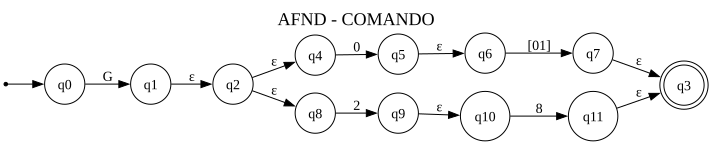

M = (Q, Σ, δ, q₀, F)

- Q = {q0, q1, q2, q3, q4, q5, q6, q7, q8, q9, q10, q11}
- Σ = {0, 1, 2, 8, G}
- q₀ = q0
- F = {q3}
- δ: tabla siguiente; ε no pertenece a Σ.

| Estado | 0 | 1 | 2 | 8 | G | ε |
| --- | --- | --- | --- | --- | --- | --- |
| →q0 | ∅ | ∅ | ∅ | ∅ | q1 | ∅ |
| q1 | ∅ | ∅ | ∅ | ∅ | ∅ | q2 |
| q2 | ∅ | ∅ | ∅ | ∅ | ∅ | q4, q8 |
| *q3 | ∅ | ∅ | ∅ | ∅ | ∅ | ∅ |
| q4 | q5 | ∅ | ∅ | ∅ | ∅ | ∅ |
| q5 | ∅ | ∅ | ∅ | ∅ | ∅ | q6 |
| q6 | q7 | q7 | ∅ | ∅ | ∅ | ∅ |
| q7 | ∅ | ∅ | ∅ | ∅ | ∅ | q3 |
| q8 | ∅ | ∅ | q9 | ∅ | ∅ | ∅ |
| q9 | ∅ | ∅ | ∅ | ∅ | ∅ | q10 |
| q10 | ∅ | ∅ | ∅ | q11 | ∅ | ∅ |
| q11 | ∅ | ∅ | ∅ | ∅ | ∅ | q3 |

→ inicial; * aceptación; ∅ sin destinos.

#### AFD

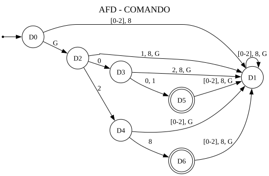

M = (Q, Σ, δ, q₀, F)

- Q = {D0, D1, D2, D3, D4, D5, D6}
- Σ = {0, 1, 2, 8, G}
- q₀ = D0
- F = {D5, D6}
- δ: tabla siguiente; ε no pertenece a Σ.

| Estado | 0 | 1 | 2 | 8 | G |
| --- | --- | --- | --- | --- | --- |
| →D0 | D1 | D1 | D1 | D1 | D2 |
| D1 | D1 | D1 | D1 | D1 | D1 |
| D2 | D3 | D1 | D4 | D1 | D1 |
| D3 | D5 | D5 | D1 | D1 | D1 |
| D4 | D1 | D1 | D1 | D6 | D1 |
| *D5 | D1 | D1 | D1 | D1 | D1 |
| *D6 | D1 | D1 | D1 | D1 | D1 |

→ inicial; * aceptación; ∅ sin destinos.

Subconjuntos del AFND:

- D0 = {q0}
- D1 = {}
- D2 = {q1, q2, q4, q8}
- D3 = {q5, q6}
- D4 = {q9, q10}
- D5 = {q3, q7}
- D6 = {q3, q11}

#### AFD mínimo

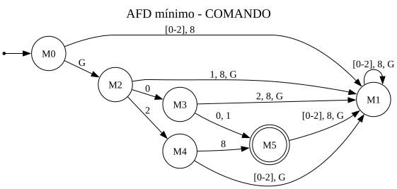

M = (Q, Σ, δ, q₀, F)

- Q = {M0, M1, M2, M3, M4, M5}
- Σ = {0, 1, 2, 8, G}
- q₀ = M0
- F = {M5}
- δ: tabla siguiente; ε no pertenece a Σ.

| Estado | 0 | 1 | 2 | 8 | G |
| --- | --- | --- | --- | --- | --- |
| →M0 | M1 | M1 | M1 | M1 | M2 |
| M1 | M1 | M1 | M1 | M1 | M1 |
| M2 | M3 | M1 | M4 | M1 | M1 |
| M3 | M5 | M5 | M1 | M1 | M1 |
| M4 | M1 | M1 | M1 | M5 | M1 |
| *M5 | M1 | M1 | M1 | M1 | M1 |

→ inicial; * aceptación; ∅ sin destinos.

Estados AFD agrupados:

- M0 = {D0}
- M1 = {D1}
- M2 = {D2}
- M3 = {D3}
- M4 = {D4}
- M5 = {D5, D6}

### COORDENADA_X

`X[0-9]{2}`

Ejemplos válidos: `X01`; `X00`; `X99`.

Ejemplos inválidos: `X1`; `X100`; `X-1`.

#### AFND

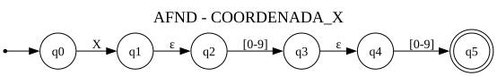

M = (Q, Σ, δ, q₀, F)

- Q = {q0, q1, q2, q3, q4, q5}
- Σ = {0, 1, 2, 3, 4, 5, 6, 7, 8, 9, X}
- q₀ = q0
- F = {q5}
- δ: tabla siguiente; ε no pertenece a Σ.

| Estado | [0-9] | X | ε |
| --- | --- | --- | --- |
| →q0 | ∅ | q1 | ∅ |
| q1 | ∅ | ∅ | q2 |
| q2 | q3 | ∅ | ∅ |
| q3 | ∅ | ∅ | q4 |
| q4 | q5 | ∅ | ∅ |
| *q5 | ∅ | ∅ | ∅ |

→ inicial; * aceptación; ∅ sin destinos.

#### AFD

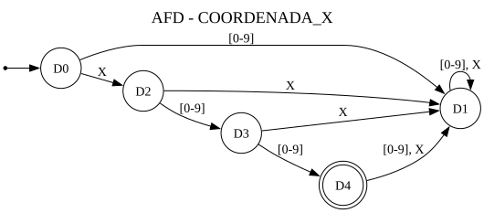

M = (Q, Σ, δ, q₀, F)

- Q = {D0, D1, D2, D3, D4}
- Σ = {0, 1, 2, 3, 4, 5, 6, 7, 8, 9, X}
- q₀ = D0
- F = {D4}
- δ: tabla siguiente; ε no pertenece a Σ.

| Estado | [0-9] | X |
| --- | --- | --- |
| →D0 | D1 | D2 |
| D1 | D1 | D1 |
| D2 | D3 | D1 |
| D3 | D4 | D1 |
| *D4 | D1 | D1 |

→ inicial; * aceptación; ∅ sin destinos.

Subconjuntos del AFND:

- D0 = {q0}
- D1 = {}
- D2 = {q1, q2}
- D3 = {q3, q4}
- D4 = {q5}

#### AFD mínimo

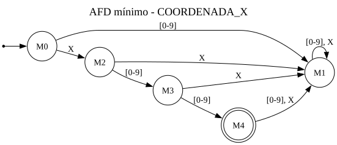

M = (Q, Σ, δ, q₀, F)

- Q = {M0, M1, M2, M3, M4}
- Σ = {0, 1, 2, 3, 4, 5, 6, 7, 8, 9, X}
- q₀ = M0
- F = {M4}
- δ: tabla siguiente; ε no pertenece a Σ.

| Estado | [0-9] | X |
| --- | --- | --- |
| →M0 | M1 | M2 |
| M1 | M1 | M1 |
| M2 | M3 | M1 |
| M3 | M4 | M1 |
| *M4 | M1 | M1 |

→ inicial; * aceptación; ∅ sin destinos.

Estados AFD agrupados:

- M0 = {D0}
- M1 = {D1}
- M2 = {D2}
- M3 = {D3}
- M4 = {D4}

### COORDENADA_Y

`Y[0-9]{2}`

Ejemplos válidos: `Y20`; `Y00`; `Y99`.

Ejemplos inválidos: `Y2`; `Y100`; `y20`.

#### AFND

M = (Q, Σ, δ, q₀, F)

- Q = {q0, q1, q2, q3, q4, q5}
- Σ = {0, 1, 2, 3, 4, 5, 6, 7, 8, 9, Y}
- q₀ = q0
- F = {q5}
- δ: tabla siguiente; ε no pertenece a Σ.

| Estado | [0-9] | Y | ε |
| --- | --- | --- | --- |
| →q0 | ∅ | q1 | ∅ |
| q1 | ∅ | ∅ | q2 |
| q2 | q3 | ∅ | ∅ |
| q3 | ∅ | ∅ | q4 |
| q4 | q5 | ∅ | ∅ |
| *q5 | ∅ | ∅ | ∅ |

→ inicial; * aceptación; ∅ sin destinos.

#### AFD

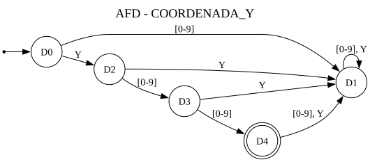

M = (Q, Σ, δ, q₀, F)

- Q = {D0, D1, D2, D3, D4}
- Σ = {0, 1, 2, 3, 4, 5, 6, 7, 8, 9, Y}
- q₀ = D0
- F = {D4}
- δ: tabla siguiente; ε no pertenece a Σ.

| Estado | [0-9] | Y |
| --- | --- | --- |
| →D0 | D1 | D2 |
| D1 | D1 | D1 |
| D2 | D3 | D1 |
| D3 | D4 | D1 |
| *D4 | D1 | D1 |

→ inicial; * aceptación; ∅ sin destinos.

Subconjuntos del AFND:

- D0 = {q0}
- D1 = {}
- D2 = {q1, q2}
- D3 = {q3, q4}
- D4 = {q5}

#### AFD mínimo

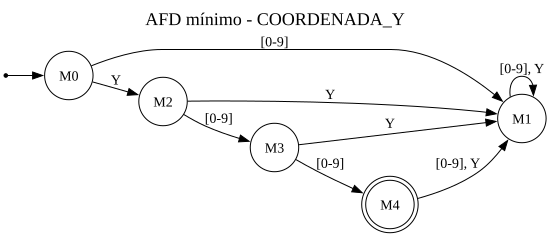

M = (Q, Σ, δ, q₀, F)

- Q = {M0, M1, M2, M3, M4}
- Σ = {0, 1, 2, 3, 4, 5, 6, 7, 8, 9, Y}
- q₀ = M0
- F = {M4}
- δ: tabla siguiente; ε no pertenece a Σ.

| Estado | [0-9] | Y |
| --- | --- | --- |
| →M0 | M1 | M2 |
| M1 | M1 | M1 |
| M2 | M3 | M1 |
| M3 | M4 | M1 |
| *M4 | M1 | M1 |

→ inicial; * aceptación; ∅ sin destinos.

Estados AFD agrupados:

- M0 = {D0}
- M1 = {D1}
- M2 = {D2}
- M3 = {D3}
- M4 = {D4}

### VELOCIDAD

`F[1-9][0-9]{0,2}`

Ejemplos válidos: `F1`; `F120`; `F999`.

Ejemplos inválidos: `F0`; `F01`; `F1000`.

#### AFND

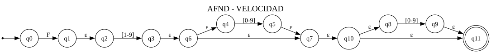

M = (Q, Σ, δ, q₀, F)

- Q = {q0, q1, q2, q3, q4, q5, q6, q7, q8, q9, q10, q11}
- Σ = {0, 1, 2, 3, 4, 5, 6, 7, 8, 9, F}
- q₀ = q0
- F = {q11}
- δ: tabla siguiente; ε no pertenece a Σ.

| Estado | 0 | [1-9] | F | ε |
| --- | --- | --- | --- | --- |
| →q0 | ∅ | ∅ | q1 | ∅ |
| q1 | ∅ | ∅ | ∅ | q2 |
| q2 | ∅ | q3 | ∅ | ∅ |
| q3 | ∅ | ∅ | ∅ | q6 |
| q4 | q5 | q5 | ∅ | ∅ |
| q5 | ∅ | ∅ | ∅ | q7 |
| q6 | ∅ | ∅ | ∅ | q4, q7 |
| q7 | ∅ | ∅ | ∅ | q10 |
| q8 | q9 | q9 | ∅ | ∅ |
| q9 | ∅ | ∅ | ∅ | q11 |
| q10 | ∅ | ∅ | ∅ | q11, q8 |
| *q11 | ∅ | ∅ | ∅ | ∅ |

→ inicial; * aceptación; ∅ sin destinos.

#### AFD

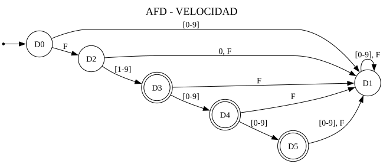

M = (Q, Σ, δ, q₀, F)

- Q = {D0, D1, D2, D3, D4, D5}
- Σ = {0, 1, 2, 3, 4, 5, 6, 7, 8, 9, F}
- q₀ = D0
- F = {D3, D4, D5}
- δ: tabla siguiente; ε no pertenece a Σ.

| Estado | 0 | [1-9] | F |
| --- | --- | --- | --- |
| →D0 | D1 | D1 | D2 |
| D1 | D1 | D1 | D1 |
| D2 | D1 | D3 | D1 |
| *D3 | D4 | D4 | D1 |
| *D4 | D5 | D5 | D1 |
| *D5 | D1 | D1 | D1 |

→ inicial; * aceptación; ∅ sin destinos.

Subconjuntos del AFND:

- D0 = {q0}
- D1 = {}
- D2 = {q1, q2}
- D3 = {q3, q4, q6, q7, q8, q10, q11}
- D4 = {q5, q7, q8, q9, q10, q11}
- D5 = {q9, q11}

#### AFD mínimo

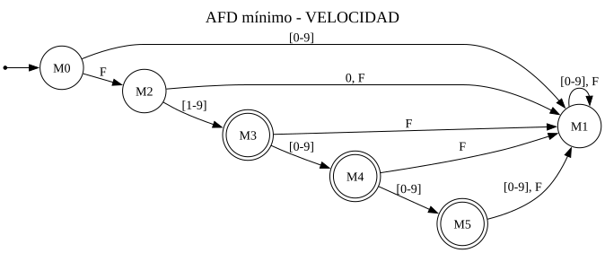

M = (Q, Σ, δ, q₀, F)

- Q = {M0, M1, M2, M3, M4, M5}
- Σ = {0, 1, 2, 3, 4, 5, 6, 7, 8, 9, F}
- q₀ = M0
- F = {M3, M4, M5}
- δ: tabla siguiente; ε no pertenece a Σ.

| Estado | 0 | [1-9] | F |
| --- | --- | --- | --- |
| →M0 | M1 | M1 | M2 |
| M1 | M1 | M1 | M1 |
| M2 | M1 | M3 | M1 |
| *M3 | M4 | M4 | M1 |
| *M4 | M5 | M5 | M1 |
| *M5 | M1 | M1 | M1 |

→ inicial; * aceptación; ∅ sin destinos.

Estados AFD agrupados:

- M0 = {D0}
- M1 = {D1}
- M2 = {D2}
- M3 = {D3}
- M4 = {D4}
- M5 = {D5}

### FIN_INSTRUCCION

`;`

Ejemplos válidos: `;`.

Ejemplos inválidos: ``; `;;`; `:`.

#### AFND

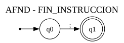

M = (Q, Σ, δ, q₀, F)

- Q = {q0, q1}
- Σ = {;}
- q₀ = q0
- F = {q1}
- δ: tabla siguiente; ε no pertenece a Σ.

| Estado | ; | ε |
| --- | --- | --- |
| →q0 | q1 | ∅ |
| *q1 | ∅ | ∅ |

→ inicial; * aceptación; ∅ sin destinos.

#### AFD

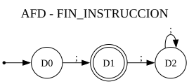

M = (Q, Σ, δ, q₀, F)

- Q = {D0, D1, D2}
- Σ = {;}
- q₀ = D0
- F = {D1}
- δ: tabla siguiente; ε no pertenece a Σ.

| Estado | ; |
| --- | --- |
| →D0 | D1 |
| *D1 | D2 |
| D2 | D2 |

→ inicial; * aceptación; ∅ sin destinos.

Subconjuntos del AFND:

- D0 = {q0}
- D1 = {q1}
- D2 = {}

#### AFD mínimo

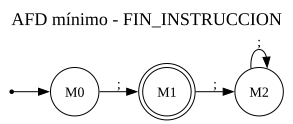

M = (Q, Σ, δ, q₀, F)

- Q = {M0, M1, M2}
- Σ = {;}
- q₀ = M0
- F = {M1}
- δ: tabla siguiente; ε no pertenece a Σ.

| Estado | ; |
| --- | --- |
| →M0 | M1 |
| *M1 | M2 |
| M2 | M2 |

→ inicial; * aceptación; ∅ sin destinos.

Estados AFD agrupados:

- M0 = {D0}
- M1 = {D1}
- M2 = {D2}

## Validación reproducible

Ejecutar primero `python generar_frontend.py`, después `python -m unittest discover -v`, `node --test test_cliente.cjs` y, con Flask iniciado, `python verificar_http.py http://127.0.0.1:5000`. Las pruebas comparan lexemas con las expresiones originales, recorren todos los subconjuntos alcanzables y comprueban tablas, quíntuplas, SVG, API, TXT, límites y CORS. `test_paridad.py` compara los modelos Python/JavaScript y ejecuta un build limpio sin backend. La comprobación de Gunicorn se omite en Windows y debe ejecutarse en Linux/Docker.

Los dominios remotos son conocidos, pero sigue pendiente aplicar la configuracion y comprobar una compilacion desde Netlify. Los documentos originales se localizaron en el Escritorio y se revisaron; no se han modificado. Este material contiene resultados editables para incorporarlos a la etapa 2.
