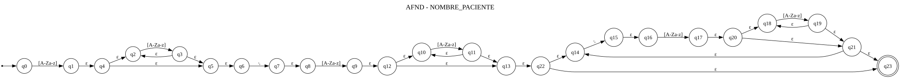
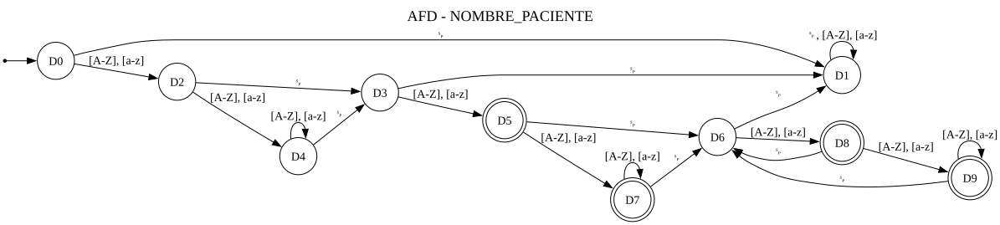
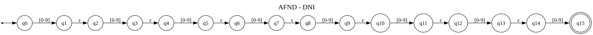
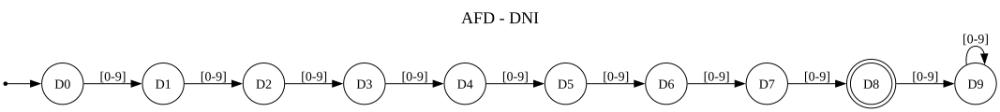
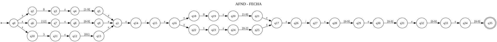
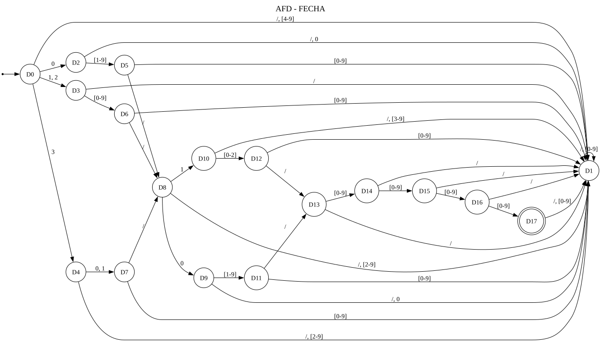
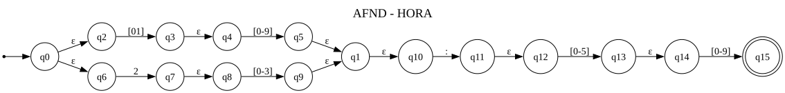
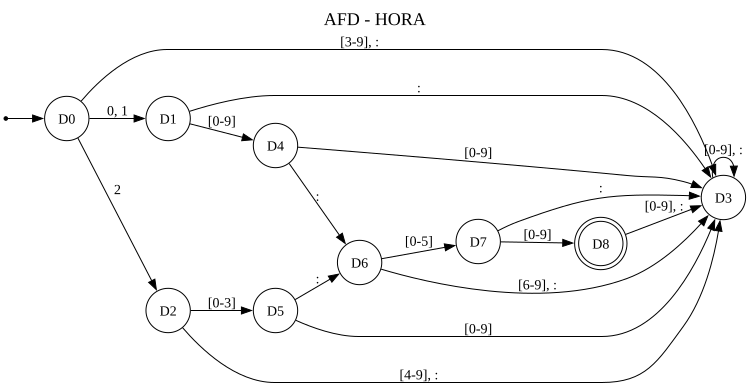
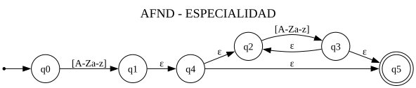
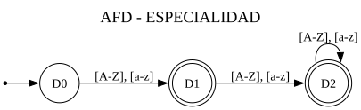

# Avance verificado de la etapa 2: citas médicas

Material para incorporar al Word original. No sustituye su estructura ni presume revisar los documentos académicos ausentes.

## Alcance implementado

Se conservaron Flask, Graphviz, la conversión por subconjuntos, el cliente y el despliegue. Se amplió el parser de expresiones regulares y se adaptaron los cinco tokens al registro de citas médicas.

El parser produce un árbol de alternativas, concatenaciones, repeticiones y símbolos. Thompson genera los fragmentos con estados independientes y transiciones ε. La conversión calcula el cierre ε inicial y, por cada símbolo de Σ, el cierre ε del movimiento desde cada subconjunto. Un subconjunto es final si contiene algún estado final del AFND. El subconjunto vacío se conserva como sumidero. No se aplica minimización.

El gráfico, la quíntupla y la tabla se obtienen del mismo autómata. Las columnas agrupan caracteres solo si coinciden sus destinos en todos los estados; las aristas agrupan etiquetas por origen y destino. ␠ representa espacio literal.

## Entrada y limitaciones conservadas

`Joaquin Esquivez 74839261 25/09/2026 10:30 Cardiologia`

Un registro por línea. Los cuatro últimos campos son DNI, fecha, hora y especialidad; el prefijo completo es el nombre. Se informa línea, columna y campo inválido. Se conservan las expresiones originales: letras ASCII sin tildes ni ñ y especialidad de una palabra. FECHA reconoce formato y rangos básicos; 31/02/2026 es un lexema reconocido aunque no exista en el calendario. No se comprueban identidad, disponibilidad ni citas reales. La gramática sintáctica completa de la etapa 3 queda pendiente.

## Resultados generados

### NOMBRE_PACIENTE

`[A-Za-z]+( [A-Za-z]+)+`

Ejemplos válidos: `Joaquin Esquivez`; `Mateo Salazar`; `Maria Lopez`; `Gabriel Castillo`.

Ejemplos inválidos: `Joaquin`; `Mateo7 Salazar`; `Maria`; `Gabriel Castillo9`.

#### AFND

M = (Q, Σ, δ, q₀, F)

- Q = {q0, q1, q2, q3, q4, q5, q6, q7, q8, q9, q10, q11, q12, q13, q14, q15, q16, q17, q18, q19, q20, q21, q22, q23}
- Σ = {␠, A, B, C, D, E, F, G, H, I, J, K, L, M, N, O, P, Q, R, S, T, U, V, W, X, Y, Z, a, b, c, d, e, f, g, h, i, j, k, l, m, n, o, p, q, r, s, t, u, v, w, x, y, z}
- q₀ = q0
- F = {q23}
- δ: tabla siguiente; ε no pertenece a Σ.

| Estado | ␠ | [A-Z], [a-z] | ε |
| --- | --- | --- | --- |
| →q0 | ∅ | q1 | ∅ |
| q1 | ∅ | ∅ | q4 |
| q2 | ∅ | q3 | ∅ |
| q3 | ∅ | ∅ | q2, q5 |
| q4 | ∅ | ∅ | q2, q5 |
| q5 | ∅ | ∅ | q6 |
| q6 | q7 | ∅ | ∅ |
| q7 | ∅ | ∅ | q8 |
| q8 | ∅ | q9 | ∅ |
| q9 | ∅ | ∅ | q12 |
| q10 | ∅ | q11 | ∅ |
| q11 | ∅ | ∅ | q10, q13 |
| q12 | ∅ | ∅ | q10, q13 |
| q13 | ∅ | ∅ | q22 |
| q14 | q15 | ∅ | ∅ |
| q15 | ∅ | ∅ | q16 |
| q16 | ∅ | q17 | ∅ |
| q17 | ∅ | ∅ | q20 |
| q18 | ∅ | q19 | ∅ |
| q19 | ∅ | ∅ | q18, q21 |
| q20 | ∅ | ∅ | q18, q21 |
| q21 | ∅ | ∅ | q14, q23 |
| q22 | ∅ | ∅ | q14, q23 |
| *q23 | ∅ | ∅ | ∅ |

→ inicial; * aceptación; ∅ sin destinos.

#### AFD

M = (Q, Σ, δ, q₀, F)

- Q = {D0, D1, D2, D3, D4, D5, D6, D7, D8, D9}
- Σ = {␠, A, B, C, D, E, F, G, H, I, J, K, L, M, N, O, P, Q, R, S, T, U, V, W, X, Y, Z, a, b, c, d, e, f, g, h, i, j, k, l, m, n, o, p, q, r, s, t, u, v, w, x, y, z}
- q₀ = D0
- F = {D5, D7, D8, D9}
- δ: tabla siguiente; ε no pertenece a Σ.

| Estado | ␠ | [A-Z], [a-z] |
| --- | --- | --- |
| →D0 | D1 | D2 |
| D1 | D1 | D1 |
| D2 | D3 | D4 |
| D3 | D1 | D5 |
| D4 | D3 | D4 |
| *D5 | D6 | D7 |
| D6 | D1 | D8 |
| *D7 | D6 | D7 |
| *D8 | D6 | D9 |
| *D9 | D6 | D9 |

→ inicial; * aceptación; ∅ sin destinos.

Subconjuntos del AFND:

- D0 = {q0}
- D1 = {}
- D2 = {q1, q2, q4, q5, q6}
- D3 = {q7, q8}
- D4 = {q2, q3, q5, q6}
- D5 = {q9, q10, q12, q13, q14, q22, q23}
- D6 = {q15, q16}
- D7 = {q10, q11, q13, q14, q22, q23}
- D8 = {q14, q17, q18, q20, q21, q23}
- D9 = {q14, q18, q19, q21, q23}

### DNI

`[0-9]{8}`

Ejemplos válidos: `74839261`; `00000000`.

Ejemplos inválidos: `1234567`; `123456789`.

#### AFND

M = (Q, Σ, δ, q₀, F)

- Q = {q0, q1, q2, q3, q4, q5, q6, q7, q8, q9, q10, q11, q12, q13, q14, q15}
- Σ = {0, 1, 2, 3, 4, 5, 6, 7, 8, 9}
- q₀ = q0
- F = {q15}
- δ: tabla siguiente; ε no pertenece a Σ.

| Estado | [0-9] | ε |
| --- | --- | --- |
| →q0 | q1 | ∅ |
| q1 | ∅ | q2 |
| q2 | q3 | ∅ |
| q3 | ∅ | q4 |
| q4 | q5 | ∅ |
| q5 | ∅ | q6 |
| q6 | q7 | ∅ |
| q7 | ∅ | q8 |
| q8 | q9 | ∅ |
| q9 | ∅ | q10 |
| q10 | q11 | ∅ |
| q11 | ∅ | q12 |
| q12 | q13 | ∅ |
| q13 | ∅ | q14 |
| q14 | q15 | ∅ |
| *q15 | ∅ | ∅ |

→ inicial; * aceptación; ∅ sin destinos.

#### AFD

M = (Q, Σ, δ, q₀, F)

- Q = {D0, D1, D2, D3, D4, D5, D6, D7, D8, D9}
- Σ = {0, 1, 2, 3, 4, 5, 6, 7, 8, 9}
- q₀ = D0
- F = {D8}
- δ: tabla siguiente; ε no pertenece a Σ.

| Estado | [0-9] |
| --- | --- |
| →D0 | D1 |
| D1 | D2 |
| D2 | D3 |
| D3 | D4 |
| D4 | D5 |
| D5 | D6 |
| D6 | D7 |
| D7 | D8 |
| *D8 | D9 |
| D9 | D9 |

→ inicial; * aceptación; ∅ sin destinos.

Subconjuntos del AFND:

- D0 = {q0}
- D1 = {q1, q2}
- D2 = {q3, q4}
- D3 = {q5, q6}
- D4 = {q7, q8}
- D5 = {q9, q10}
- D6 = {q11, q12}
- D7 = {q13, q14}
- D8 = {q15}
- D9 = {}

### FECHA

`(0[1-9]|[12][0-9]|3[01])/(0[1-9]|1[0-2])/[0-9]{4}`

Ejemplos válidos: `25/09/2026`; `31/02/2026`.

Ejemplos inválidos: `00/09/2026`; `25/13/2026`.

#### AFND

M = (Q, Σ, δ, q₀, F)

- Q = {q0, q1, q2, q3, q4, q5, q6, q7, q8, q9, q10, q11, q12, q13, q14, q15, q16, q17, q18, q19, q20, q21, q22, q23, q24, q25, q26, q27, q28, q29, q30, q31, q32, q33, q34, q35}
- Σ = {/, 0, 1, 2, 3, 4, 5, 6, 7, 8, 9}
- q₀ = q0
- F = {q35}
- δ: tabla siguiente; ε no pertenece a Σ.

| Estado | / | 0 | 1 | 2 | 3 | [4-9] | ε |
| --- | --- | --- | --- | --- | --- | --- | --- |
| →q0 | ∅ | ∅ | ∅ | ∅ | ∅ | ∅ | q10, q2, q6 |
| q1 | ∅ | ∅ | ∅ | ∅ | ∅ | ∅ | q14 |
| q2 | ∅ | q3 | ∅ | ∅ | ∅ | ∅ | ∅ |
| q3 | ∅ | ∅ | ∅ | ∅ | ∅ | ∅ | q4 |
| q4 | ∅ | ∅ | q5 | q5 | q5 | q5 | ∅ |
| q5 | ∅ | ∅ | ∅ | ∅ | ∅ | ∅ | q1 |
| q6 | ∅ | ∅ | q7 | q7 | ∅ | ∅ | ∅ |
| q7 | ∅ | ∅ | ∅ | ∅ | ∅ | ∅ | q8 |
| q8 | ∅ | q9 | q9 | q9 | q9 | q9 | ∅ |
| q9 | ∅ | ∅ | ∅ | ∅ | ∅ | ∅ | q1 |
| q10 | ∅ | ∅ | ∅ | ∅ | q11 | ∅ | ∅ |
| q11 | ∅ | ∅ | ∅ | ∅ | ∅ | ∅ | q12 |
| q12 | ∅ | q13 | q13 | ∅ | ∅ | ∅ | ∅ |
| q13 | ∅ | ∅ | ∅ | ∅ | ∅ | ∅ | q1 |
| q14 | q15 | ∅ | ∅ | ∅ | ∅ | ∅ | ∅ |
| q15 | ∅ | ∅ | ∅ | ∅ | ∅ | ∅ | q16 |
| q16 | ∅ | ∅ | ∅ | ∅ | ∅ | ∅ | q18, q22 |
| q17 | ∅ | ∅ | ∅ | ∅ | ∅ | ∅ | q26 |
| q18 | ∅ | q19 | ∅ | ∅ | ∅ | ∅ | ∅ |
| q19 | ∅ | ∅ | ∅ | ∅ | ∅ | ∅ | q20 |
| q20 | ∅ | ∅ | q21 | q21 | q21 | q21 | ∅ |
| q21 | ∅ | ∅ | ∅ | ∅ | ∅ | ∅ | q17 |
| q22 | ∅ | ∅ | q23 | ∅ | ∅ | ∅ | ∅ |
| q23 | ∅ | ∅ | ∅ | ∅ | ∅ | ∅ | q24 |
| q24 | ∅ | q25 | q25 | q25 | ∅ | ∅ | ∅ |
| q25 | ∅ | ∅ | ∅ | ∅ | ∅ | ∅ | q17 |
| q26 | q27 | ∅ | ∅ | ∅ | ∅ | ∅ | ∅ |
| q27 | ∅ | ∅ | ∅ | ∅ | ∅ | ∅ | q28 |
| q28 | ∅ | q29 | q29 | q29 | q29 | q29 | ∅ |
| q29 | ∅ | ∅ | ∅ | ∅ | ∅ | ∅ | q30 |
| q30 | ∅ | q31 | q31 | q31 | q31 | q31 | ∅ |
| q31 | ∅ | ∅ | ∅ | ∅ | ∅ | ∅ | q32 |
| q32 | ∅ | q33 | q33 | q33 | q33 | q33 | ∅ |
| q33 | ∅ | ∅ | ∅ | ∅ | ∅ | ∅ | q34 |
| q34 | ∅ | q35 | q35 | q35 | q35 | q35 | ∅ |
| *q35 | ∅ | ∅ | ∅ | ∅ | ∅ | ∅ | ∅ |

→ inicial; * aceptación; ∅ sin destinos.

#### AFD

M = (Q, Σ, δ, q₀, F)

- Q = {D0, D1, D2, D3, D4, D5, D6, D7, D8, D9, D10, D11, D12, D13, D14, D15, D16, D17}
- Σ = {/, 0, 1, 2, 3, 4, 5, 6, 7, 8, 9}
- q₀ = D0
- F = {D17}
- δ: tabla siguiente; ε no pertenece a Σ.

| Estado | / | 0 | 1 | 2 | 3 | [4-9] |
| --- | --- | --- | --- | --- | --- | --- |
| →D0 | D1 | D2 | D3 | D3 | D4 | D1 |
| D1 | D1 | D1 | D1 | D1 | D1 | D1 |
| D2 | D1 | D1 | D5 | D5 | D5 | D5 |
| D3 | D1 | D6 | D6 | D6 | D6 | D6 |
| D4 | D1 | D7 | D7 | D1 | D1 | D1 |
| D5 | D8 | D1 | D1 | D1 | D1 | D1 |
| D6 | D8 | D1 | D1 | D1 | D1 | D1 |
| D7 | D8 | D1 | D1 | D1 | D1 | D1 |
| D8 | D1 | D9 | D10 | D1 | D1 | D1 |
| D9 | D1 | D1 | D11 | D11 | D11 | D11 |
| D10 | D1 | D12 | D12 | D12 | D1 | D1 |
| D11 | D13 | D1 | D1 | D1 | D1 | D1 |
| D12 | D13 | D1 | D1 | D1 | D1 | D1 |
| D13 | D1 | D14 | D14 | D14 | D14 | D14 |
| D14 | D1 | D15 | D15 | D15 | D15 | D15 |
| D15 | D1 | D16 | D16 | D16 | D16 | D16 |
| D16 | D1 | D17 | D17 | D17 | D17 | D17 |
| *D17 | D1 | D1 | D1 | D1 | D1 | D1 |

→ inicial; * aceptación; ∅ sin destinos.

Subconjuntos del AFND:

- D0 = {q0, q2, q6, q10}
- D1 = {}
- D2 = {q3, q4}
- D3 = {q7, q8}
- D4 = {q11, q12}
- D5 = {q1, q5, q14}
- D6 = {q1, q9, q14}
- D7 = {q1, q13, q14}
- D8 = {q15, q16, q18, q22}
- D9 = {q19, q20}
- D10 = {q23, q24}
- D11 = {q17, q21, q26}
- D12 = {q17, q25, q26}
- D13 = {q27, q28}
- D14 = {q29, q30}
- D15 = {q31, q32}
- D16 = {q33, q34}
- D17 = {q35}

### HORA

`([01][0-9]|2[0-3]):[0-5][0-9]`

Ejemplos válidos: `10:30`; `00:00`; `23:59`.

Ejemplos inválidos: `24:00`; `10:60`.

#### AFND

M = (Q, Σ, δ, q₀, F)

- Q = {q0, q1, q2, q3, q4, q5, q6, q7, q8, q9, q10, q11, q12, q13, q14, q15}
- Σ = {0, 1, 2, 3, 4, 5, 6, 7, 8, 9, :}
- q₀ = q0
- F = {q15}
- δ: tabla siguiente; ε no pertenece a Σ.

| Estado | 0, 1 | 2 | 3 | 4, 5 | [6-9] | : | ε |
| --- | --- | --- | --- | --- | --- | --- | --- |
| →q0 | ∅ | ∅ | ∅ | ∅ | ∅ | ∅ | q2, q6 |
| q1 | ∅ | ∅ | ∅ | ∅ | ∅ | ∅ | q10 |
| q2 | q3 | ∅ | ∅ | ∅ | ∅ | ∅ | ∅ |
| q3 | ∅ | ∅ | ∅ | ∅ | ∅ | ∅ | q4 |
| q4 | q5 | q5 | q5 | q5 | q5 | ∅ | ∅ |
| q5 | ∅ | ∅ | ∅ | ∅ | ∅ | ∅ | q1 |
| q6 | ∅ | q7 | ∅ | ∅ | ∅ | ∅ | ∅ |
| q7 | ∅ | ∅ | ∅ | ∅ | ∅ | ∅ | q8 |
| q8 | q9 | q9 | q9 | ∅ | ∅ | ∅ | ∅ |
| q9 | ∅ | ∅ | ∅ | ∅ | ∅ | ∅ | q1 |
| q10 | ∅ | ∅ | ∅ | ∅ | ∅ | q11 | ∅ |
| q11 | ∅ | ∅ | ∅ | ∅ | ∅ | ∅ | q12 |
| q12 | q13 | q13 | q13 | q13 | ∅ | ∅ | ∅ |
| q13 | ∅ | ∅ | ∅ | ∅ | ∅ | ∅ | q14 |
| q14 | q15 | q15 | q15 | q15 | q15 | ∅ | ∅ |
| *q15 | ∅ | ∅ | ∅ | ∅ | ∅ | ∅ | ∅ |

→ inicial; * aceptación; ∅ sin destinos.

#### AFD

M = (Q, Σ, δ, q₀, F)

- Q = {D0, D1, D2, D3, D4, D5, D6, D7, D8}
- Σ = {0, 1, 2, 3, 4, 5, 6, 7, 8, 9, :}
- q₀ = D0
- F = {D8}
- δ: tabla siguiente; ε no pertenece a Σ.

| Estado | 0, 1 | 2 | 3 | 4, 5 | [6-9] | : |
| --- | --- | --- | --- | --- | --- | --- |
| →D0 | D1 | D2 | D3 | D3 | D3 | D3 |
| D1 | D4 | D4 | D4 | D4 | D4 | D3 |
| D2 | D5 | D5 | D5 | D3 | D3 | D3 |
| D3 | D3 | D3 | D3 | D3 | D3 | D3 |
| D4 | D3 | D3 | D3 | D3 | D3 | D6 |
| D5 | D3 | D3 | D3 | D3 | D3 | D6 |
| D6 | D7 | D7 | D7 | D7 | D3 | D3 |
| D7 | D8 | D8 | D8 | D8 | D8 | D3 |
| *D8 | D3 | D3 | D3 | D3 | D3 | D3 |

→ inicial; * aceptación; ∅ sin destinos.

Subconjuntos del AFND:

- D0 = {q0, q2, q6}
- D1 = {q3, q4}
- D2 = {q7, q8}
- D3 = {}
- D4 = {q1, q5, q10}
- D5 = {q1, q9, q10}
- D6 = {q11, q12}
- D7 = {q13, q14}
- D8 = {q15}

### ESPECIALIDAD

`[A-Za-z]+`

Ejemplos válidos: `Cardiologia`; `Pediatria`.

Ejemplos inválidos: `Cardiología`; `Medicina General`.

#### AFND

M = (Q, Σ, δ, q₀, F)

- Q = {q0, q1, q2, q3, q4, q5}
- Σ = {A, B, C, D, E, F, G, H, I, J, K, L, M, N, O, P, Q, R, S, T, U, V, W, X, Y, Z, a, b, c, d, e, f, g, h, i, j, k, l, m, n, o, p, q, r, s, t, u, v, w, x, y, z}
- q₀ = q0
- F = {q5}
- δ: tabla siguiente; ε no pertenece a Σ.

| Estado | [A-Z], [a-z] | ε |
| --- | --- | --- |
| →q0 | q1 | ∅ |
| q1 | ∅ | q4 |
| q2 | q3 | ∅ |
| q3 | ∅ | q2, q5 |
| q4 | ∅ | q2, q5 |
| *q5 | ∅ | ∅ |

→ inicial; * aceptación; ∅ sin destinos.

#### AFD

M = (Q, Σ, δ, q₀, F)

- Q = {D0, D1, D2}
- Σ = {A, B, C, D, E, F, G, H, I, J, K, L, M, N, O, P, Q, R, S, T, U, V, W, X, Y, Z, a, b, c, d, e, f, g, h, i, j, k, l, m, n, o, p, q, r, s, t, u, v, w, x, y, z}
- q₀ = D0
- F = {D1, D2}
- δ: tabla siguiente; ε no pertenece a Σ.

| Estado | [A-Z], [a-z] |
| --- | --- |
| →D0 | D1 |
| *D1 | D2 |
| *D2 | D2 |

→ inicial; * aceptación; ∅ sin destinos.

Subconjuntos del AFND:

- D0 = {q0}
- D1 = {q1, q2, q4, q5}
- D2 = {q2, q3, q5}

## Validación reproducible

Ejecutar `python -m unittest discover -v`, `node --test test_cliente.cjs` y, con Flask iniciado, `python verificar_http.py http://127.0.0.1:5000`. Las pruebas comparan lexemas con las expresiones originales, recorren todos los subconjuntos alcanzables y comprueban tablas, quíntuplas, SVG, API, TXT, límites y CORS. La comprobación de Gunicorn se omite en Windows y debe ejecutarse en Linux/Docker.

La publicación remota y la edición de los dos Word originales siguen pendientes: no se dispone aquí de sus cuentas/dominios ni de esos documentos.
